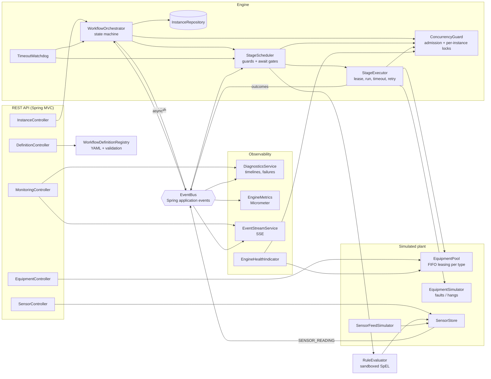

# PlantLoom

**Event-driven industrial workflow orchestrator** - a Java / Spring Boot service that sequences
multi-stage plant processes (mix -> pasteurise -> fill -> cap -> inspect, load -> machine ->
unload, ...) across a pool of simulated equipment.

Stages are triggered by events, gated by rules, run concurrently across many workflow
instances, protected by equipment-level concurrency control, bounded by timeouts with retry,
and fully observable through structured diagnostics, metrics and a live event stream.

## Features

- **Declarative workflows** in YAML: ordered stages with equipment type, nominal duration,
  per-attempt timeout, retry policy (exponential backoff), `when` guard, `await` trigger and
  output variables. Definitions are validated on load (and when registered over the API).
- **Event-driven engine**: every state change is an immutable, sequenced `WorkflowEvent`
  published on Spring's event bus; the orchestrator is a state machine reacting to them on an
  async worker pool.
- **Rule evaluation**: guards and triggers are SpEL expressions over `vars[...]`,
  `sensors[...]` and `stages[...]`, evaluated in a read-only sandbox (no type access, no method
  calls) with parsed-expression caching.
- **Sensor-triggered stages**: an `await` stage parks in `WAITING` until a sensor reading makes
  its condition true (readings come from a random-walk feed simulator or `POST /api/sensors`).
- **Concurrency control**
  - admission control: a semaphore caps concurrently active instances (HTTP 429 when full)
  - per-instance serialization: all transitions of one instance run under its lock, so
    completions, timeouts and cancels racing on different threads apply one at a time
  - equipment pool: non-blocking, FIFO-fair leasing per equipment type; a unit is never leased
    twice, abandoned waiters are skipped, leases are idempotently released
- **Timeouts at three levels**: equipment acquisition, per-attempt stage execution
  (`CompletableFuture.orTimeout`), and a watchdog for await timeouts and instance deadlines.
- **Equipment simulation**: jittered cycle times, random faults with type-specific fault codes,
  and "hung controller" injection to exercise the timeout path. Units can be put into
  maintenance at runtime.
- **Diagnostics & monitoring**: per-instance event timelines, recent-failure log, diagnostics
  summary, Server-Sent Events stream, Micrometer metrics, a custom `engine` health indicator and
  MDC-correlated (optionally ECS/JSON) logs.

## Architecture



### Instance lifecycle

```
INSTANCE_STARTED -> STAGE_READY -> [guard false]  -> STAGE_SKIPPED --------------------+
                                -> [await unmet] -> STAGE_WAITING -> STAGE_TRIGGERED -+ |
                                -> STAGE_STARTED -> EQUIPMENT_ACQUIRED                | |
                                     -> STAGE_COMPLETED ---------------------------+  | |
                                     -> fault/timeout -> STAGE_RETRY_SCHEDULED     |  | |
                                          -> (retries exhausted) STAGE_FAILED /    |  | |
                                             STAGE_TIMED_OUT -> INSTANCE_FAILED /  |  | |
                                             INSTANCE_TIMED_OUT                    |  | |
           next stage <------------------------------------------------------------+--+-+
           no stages left -> INSTANCE_COMPLETED
```

## Project layout

```
src/main/java/com/plantloom
├── api/            REST controllers, DTOs, problem-detail error mapping
├── config/         @ConfigurationProperties, thread pools
├── definition/     YAML loading + validation of workflow definitions
├── diagnostics/    timelines, metrics, health, SSE stream
├── domain/         definitions (records) and runtime instance/stage state
├── engine/         orchestrator, scheduler, executor, watchdog, concurrency guard
├── equipment/      equipment units, pool/leases, simulator
├── event/          WorkflowEvent, EventType, EventBus
├── rules/          SpEL rule evaluator
├── sensor/         sensor store
└── simulation/     sensor feed, load generator, seeded randomness
src/main/resources/workflows/   bottling-line, cnc-machining, paint-shop
```

## Running

Requirements: **JDK 17+** and **Maven 3.9+**. No external services, hardware or credentials are
needed - equipment and sensors are simulated in-process.

```bash
mvn spring-boot:run                                              # http://localhost:8080
SPRING_PROFILES_ACTIVE=load mvn spring-boot:run                  # burst load demo
SPRING_PROFILES_ACTIVE=json mvn spring-boot:run                  # ECS JSON logs
PLANTLOOM_FAILURE_RATE=0.3 PLANTLOOM_TIME_SCALE=0.2 mvn spring-boot:run   # chaos, fast
```

Or build a jar: `mvn package && java -jar target/plantloom-0.1.0-SNAPSHOT.jar`.

See `.env.example` and `src/main/resources/application.yml` for every setting
(equipment counts, timeouts, failure/hang rates, sensor channels, diagnostics buffer sizes).

### Try it

```bash
# start a bottling run (inspection skipped)
curl -s -XPOST localhost:8080/api/instances -H 'Content-Type: application/json' \
  -d '{"definitionId":"bottling-line","variables":{"qualityCheck":false}}'

# start 50 CNC jobs at once
curl -s -XPOST localhost:8080/api/instances/batch -H 'Content-Type: application/json' \
  -d '{"definitionId":"cnc-machining","count":50,"variables":{"finish":"fine"}}'

# watch the plant live
curl -N localhost:8080/api/monitoring/stream

# inspect an instance and its event timeline
curl -s localhost:8080/api/instances/<id>
curl -s localhost:8080/api/instances/<id>/timeline

# push a sensor reading (releases stages awaiting it), take a machine offline
curl -s -XPOST localhost:8080/api/sensors -H 'Content-Type: application/json' \
  -d '{"sensorId":"booth.humidity","value":42}'
curl -s -XPOST localhost:8080/api/equipment/CNC-1/maintenance -H 'Content-Type: application/json' \
  -d '{"enabled":true}'

# diagnostics, metrics, health
curl -s localhost:8080/api/monitoring/diagnostics
curl -s localhost:8080/actuator/metrics/plantloom.stage.duration
curl -s localhost:8080/actuator/health/engine
```

### API summary

| Method | Path | Purpose |
| --- | --- | --- |
| GET | `/api/definitions` / `/{id}` | List / get workflow definitions |
| POST | `/api/definitions` | Register a definition (JSON or `application/yaml`) |
| POST | `/api/instances` | Start an instance (`202`, `429` at capacity) |
| POST | `/api/instances/batch` | Start N instances |
| GET | `/api/instances?status=&definitionId=&limit=` | List instances |
| GET | `/api/instances/{id}` | Instance detail with per-stage state |
| GET | `/api/instances/{id}/timeline` | Event timeline |
| POST | `/api/instances/{id}/cancel` | Cancel (`409` if already finished) |
| GET | `/api/equipment`, `/api/equipment/stats` | Units and per-type utilisation |
| POST | `/api/equipment/{unitId}/maintenance` | Toggle maintenance |
| GET/POST | `/api/sensors` | Read / ingest sensor values |
| POST | `/api/rules/evaluate` | Dry-run a rule expression |
| GET | `/api/monitoring/stream?instanceId=&sensors=` | SSE live events |
| GET | `/api/monitoring/diagnostics` | Engine summary |
| GET | `/api/monitoring/events?after=&limit=` | Poll recent events |
| GET | `/api/monitoring/waiting` | Stages parked on triggers |

### Writing a workflow

```yaml
id: paint-shop
variables: { coat: topcoat }
stages:
  - id: humidity-gate
    await: { condition: "sensors['booth.humidity'] < 55", timeoutMs: 45000 }
  - id: paint
    equipmentType: PAINT_BOOTH
    durationMs: 2000
    timeoutMs: 6000
    retry: { maxAttempts: 2, backoffMs: 1000 }
    set: { painted: true }
  - id: cure
    equipmentType: OVEN
    durationMs: 3000
    when: "vars['coat'] != 'primer'"
```

Drop the file in `src/main/resources/workflows/` (or point `PLANTLOOM_DEFINITIONS` at a folder)
or `POST` it to `/api/definitions`.

## Testing

```bash
mvn test
```

The suite uses JUnit 5, AssertJ, Awaitility and MockMvc, with the `test` profile
(`src/test/resources/application-test.yml`: no random faults, sensor feed off, fixture
workflows in `test-workflows/`).

- `RetryPolicyTest` - backoff math and normalisation
- `RuleEvaluatorTest` - variables/sensors/stage access, sandbox rejects `T(...)` and `new`
- `DefinitionValidatorTest` - every validation rule is reported
- `EquipmentPoolTest` - FIFO fairness, skipping abandoned waiters, idempotent release,
  maintenance, and a 200-job contention test proving units are never oversubscribed
- `WorkflowEngineIntegrationTest` - end to end: guards, sensor-triggered await, await timeout,
  retry-then-succeed, retries exhausted, hung equipment timing out, cancellation freeing
  equipment, and 60 concurrent instances on 2 mixers never exceeding 2 concurrent jobs
  (fault injection via a Mockito spy on the simulator)
- `ApiIntegrationTest` - REST endpoints, validation and error mapping
